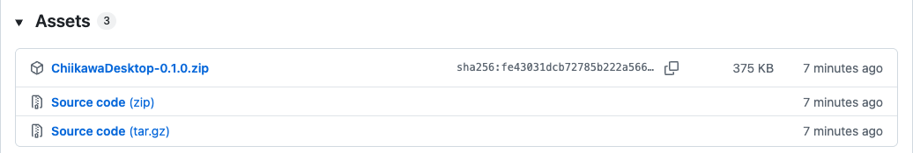
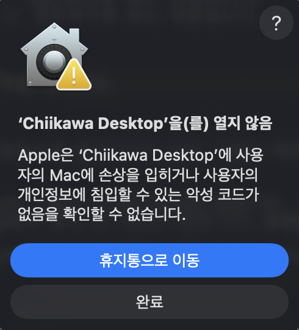
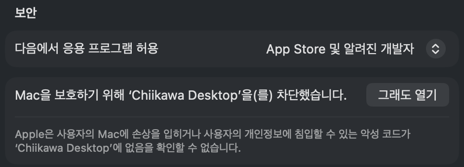
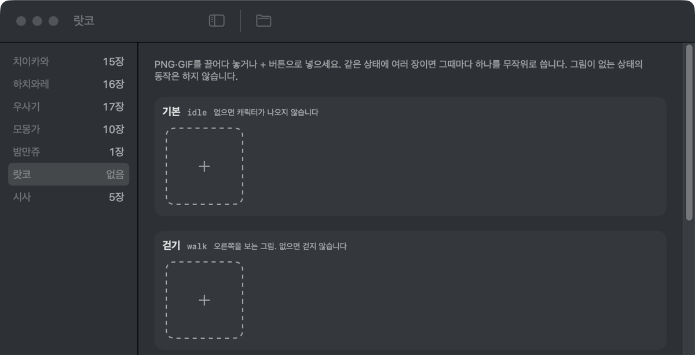

# Chiikawa Desktop

치이카와와 친구들이 macOS 바탕화면을 돌아다니는 데스크톱 펫.

> **비공식 팬메이드 (非公式・ファンメイド)** 입니다. 원작자 및 권리자와 관계없는 개인 팬 프로젝트이며, 판매·후원·광고를 하지 않습니다.
> 원작 그림은 앱과 배포 파일에 들어 있지 않습니다. 그림은 각자 가진 것을 앱에 넣어 씁니다.
> 권리자의 요청이 있으면 바로 내립니다.

등장: 그림을 넣은 캐릭터만 (치이카와, 하치와레, 우사기, 모몽가, 밤만쥬, 시사, 랏코 중)

## 설치

1. [Releases](https://github.com/seungsimdang/Chiikawa/releases)의 `Assets`에서 `ChiikawaDesktop-<버전>.zip`을 받아 풀고, `Chiikawa Desktop.app`을 `응용 프로그램` 폴더로 옮깁니다. (macOS 14 이상)

   

2. 앱을 처음 열면 아래처럼 막힙니다. Apple 개발자 인증서로 서명하지 않은 앱이라서입니다. `완료`를 누르세요(`휴지통으로 이동`은 누르지 마세요).

   

3. `시스템 설정 > 개인정보 보호 및 보안`을 열고 아래로 내려 `보안`의 `그래도 열기`를 누른 뒤, 암호나 Touch ID로 확인하고 앱을 다시 엽니다. 다시 묻는 창이 뜨면 `열기`를 누릅니다.

   

   또는 터미널에서 `xattr -dr com.apple.quarantine "/Applications/Chiikawa Desktop.app"`을 실행한 뒤 열어도 됩니다.

4. 처음 실행하면 `그림 관리` 창이 뜹니다. 캐릭터를 고르고 상태별 칸에 PNG·GIF를 끌어다 놓거나 `+`를 누르면 바로 바탕화면에 나옵니다.

   

메뉴바의 🍙 아이콘으로 조작합니다. 켜져 있을 때 앱 아이콘을 다시 열어도 `그림 관리` 창이 뜹니다.

## 직접 빌드

```sh
swift run -c release          # 바로 실행
swift run ChiikawaDesktop --selftest
./scripts/build-app.sh 0.1.0  # dist/에 .app과 zip을 만든다(ad-hoc 서명)
```

## 인터랙션

| 동작 | 반응 |
|---|---|
| 클릭 | 치이카와: 움찔(2초 안에 3번 → 울음) · 하치와레: 노래 · 우사기: 점프 · 모몽가: "칭찬해줘!" · 밤만쥬: 한 잔 "하아—!" · 랏코: 시크 · 시사: "어서 오세요!" |
| 드래그 후 놓기 | 들어 올리기 / 던지기. 세게 떨어지면 치이카와는 울고, 모몽가는 활공해서 천천히 내려온다 |
| 마우스로 문지르기 | 쓰다듬기 → 하트 |
| 키보드 타자 | 쉬거나 걷던 캐릭터가 멈춰 서서 키를 누를 때마다 콩콩 뛴다(자는 캐릭터는 그대로). 어떤 키인지는 읽지 않고 마지막 입력 시각만 본다 |
| 메뉴 `간식 주기` | 다 같이 달려가고 먼저 도착한 캐릭터가 먹는다 |
| 메뉴 `풀 뽑기 시간` / `다 같이 춤!` | 다 같이 풀 뽑기 / 춤추기 |
| 메뉴 `그림 관리…` | 캐릭터별·상태별로 그림을 넣기(끌어다 놓기 또는 +), 다른 그림으로 바꾸기, 다른 상태로 옮기기, 휴지통으로 보내기. 바꾸면 바로 반영된다 |
| 메뉴 `캐릭터` | 캐릭터별로, 또는 `모두 보이기`·`모두 숨기기`로 한 번에 보이기·숨기기 |
| 메뉴 `활동 범위` | 화면 전체 / 왼쪽 / 가운데 / 오른쪽, 또는 `마우스로 지정…`(사각형으로 드래그, 아래 변이 바닥, Esc 취소) 범위 안에서만 돌아다닌다. 점프도 범위 위로 나가지 않는다. 던지면 범위 밖으로 날아가도 걸어서 돌아온다 |
| 메뉴 `크기` | 작게(0.75배) / 보통 / 크게(1.25배) / 아주 크게(1.5배) |
| 창 위 | 가끔 근처 창 위로 뛰어올라 산책하거나 낮잠을 잔다(바닥보다 자주 잔다). 창을 옮기면 같이 움직이고, 닫히거나 가려지면 떨어진다. 활동 범위 안의 창만, 창 위치만 읽는다(제목·내용은 읽지 않는다) |
| Orca 알림 | Orca 에이전트가 일을 끝내거나 입력을 기다리면 캐릭터 하나가 노란 말풍선(`🔔 작업이 끝났어요` / `🔔 답을 기다려요`)을 띄우고 몇 초마다 튀어 오른다. 그 캐릭터를 두 번 누르면 그 세션(터미널 탭, 채팅이면 그 워크트리)으로 간다. 다른 곳에서 답해서 다시 일하기 시작하면 알림이 내려간다 |
| 메뉴 `항상 위에 표시` | 기본은 바탕화면 아이콘 바로 위(앱 창 아래), 켜면 모든 창 위 |

`캐릭터` 보이기·숨기기, `활동 범위`, `크기`, `항상 위에 표시` 설정은 저장되어 앱을 다시 켜도 유지된다.

가만히 두면 걷기, 혼잣말, 낮잠(숨 쉬듯 들썩임, 누르면 깸), 캐릭터별 버릇을 하고, 가까이 있는 캐릭터끼리 말을 주고받는다.

Orca 알림은 `orca` CLI(`/Applications/Orca.app` 안 또는 PATH)로 3초마다 `orca agent list`를 읽는다. CLI가 없으면 꺼진다. 지금 보고 있는 세션이 끝나도 알린다(CLI로는 보고 있는 세션을 알 수 없다).

## 그림

그림을 넣는 방법은 두 가지입니다. 어느 쪽이든 그림은 아래 폴더에 저장되고, 그림이 하나도 없는 캐릭터는 나오지 않습니다.

```
~/Library/Application Support/ChiikawaDesktop/<캐릭터>/
```

### 방법 1. 스크립트로 받기

`scripts/fetch-sprites.sh`는 chiikawa-wallpaper.com(비공식 팬 사이트)에서 투명 배경 스티커·GIF를 받아 위 폴더에 넣는 스크립트입니다.
이 사이트의 [이용약관](https://chiikawa-wallpaper.com/terms)은 개인 용도 사용만 허락하고, 자동화 도구로 대량 다운로드하는 것을 금지합니다. 쓰기 전에 약관을 확인하세요.

1. 저장소를 받습니다.

   ```sh
   git clone https://github.com/seungsimdang/Chiikawa.git
   cd Chiikawa
   ```

2. 스크립트를 실행합니다. 경로를 붙이면 그 폴더에 받습니다.

   ```sh
   ./scripts/fetch-sprites.sh
   ```

3. 앱을 껐다 다시 켭니다(메뉴 `종료` 후 다시 열기).

랏코는 사이트에 투명 배경 그림이 없어 스크립트로 받지 않습니다. 방법 2로 직접 넣어야 나옵니다.

### 방법 2. 직접 넣기

**그림 관리 창에서 넣기 (권장)**

1. 메뉴 `그림 관리…`를 엽니다. 앱이 켜져 있을 때 앱 아이콘을 다시 열어도 뜹니다.
2. 왼쪽에서 캐릭터를 고릅니다.
3. 상태별 칸에 PNG·GIF를 끌어다 놓거나 `+`를 눌러 고릅니다. 넣자마자 바탕화면에 반영됩니다.
4. 넣은 그림의 `…` 버튼(또는 우클릭)으로 다른 그림으로 바꾸기, 다른 상태로 옮기기, 휴지통으로 보내기를 할 수 있습니다.

**폴더에 직접 넣기**

위 폴더에 아래 이름으로 넣고 앱을 다시 켭니다.

```
<캐릭터>/<상태>.gif|png
<캐릭터>/<상태>-<아무 이름>.gif|png   # 같은 상태에 여러 장
```

- 캐릭터: `chiikawa` `hachiware` `usagi` `momonga` `kurimanju` `rakko` `shisa`
- 상태: `idle` `walk` `held` `fall` `react` `weed` `eat` `cry` `sleep` `dance`

**그림 규칙 (두 방법 공통)**

- 배경은 투명해야 합니다. `walk` 그림은 오른쪽을 보게 넣습니다
- `idle`이 없으면 캐릭터가 나오지 않습니다
- 그림이 없는 상태의 동작은 하지 않습니다(예: `walk`가 없으면 걷지 않고, `eat`이 없으면 간식을 먹으러 오지 않습니다). 들기·떨어지기는 없으면 `idle` 그림으로 합니다
- 같은 상태에 여러 장이면 그 상태가 될 때마다 하나를 무작위로 고릅니다
